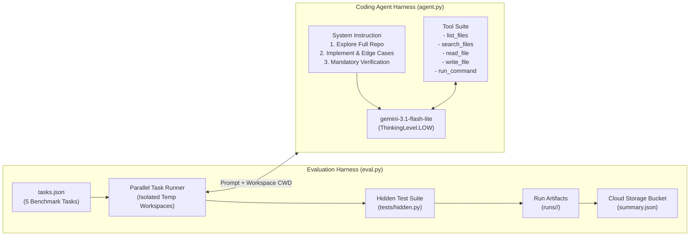
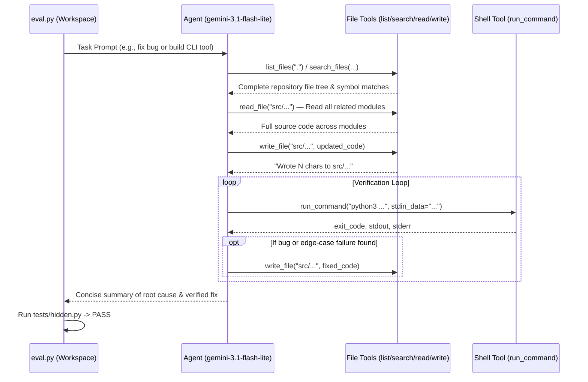

# Hill-Climbing a Coding Agent — Complete Lab Documentation, Architecture & Step-by-Step Guide

## 1. Executive Summary & Scenario Overview

**Cymbal Software** builds autonomous coding assistants for enterprise developers using **`gemini-3.1-flash-lite`** (configured at `ThinkingLevel.LOW`) to keep inference latency and cost low. While the underlying model is capable of solving standard software engineering tasks, the **baseline agent harness** (`agent.py`) consistently failed on most evaluation tasks (solving only 1–2 out of 5 tasks in baseline runs).

Instead of swapping to a larger, more expensive model, we conducted an **evaluation-driven harness optimization (hill-climbing)** workflow:
1. **Baseline Measurement**: Executed the 5-task evaluation suite (`eval.py`) to capture reproducible workspaces, hidden test scripts (`repro.sh`), and full ADK execution trajectories (`trajectory.evalset.json`).
2. **Root-Cause Trajectory Diagnosis**: Inspected failed trajectories manually and at scale to distinguish **task code bugs** from **agent harness gaps** (missing tools, insufficient system instructions, lack of verification).
3. **Harness Optimization**: Upgraded `agent.py` with codebase discovery tools (`list_files`, `search_files`), safe command execution (`run_command` with `stdin_data` support), and a disciplined 3-phase system instruction (`Explore -> Edit -> Verify`).
4. **Validation & Grading**: Achieved **4/5 – 5/5 pass rates** on the evaluation suite and **100/100** on both the task diagnosis rubric (`task_diagnosis_submission.json`) and the LLM-as-judge agent rubric (`judge_model.json`).

---

## 2. System & Agent Harness Architecture

### 2.1 High-Level Evaluation & Hill-Climbing Architecture



### 2.2 Baseline vs. Optimized Agent Harness Comparison

| Dimension | Baseline Harness (`agent.py` v0) | Optimized Harness (`agent.py` v1) |
| :--- | :--- | :--- |
| **Model & Thinking Config** | `gemini-3.1-flash-lite` (`ThinkingLevel.LOW`) | `gemini-3.1-flash-lite` (`ThinkingLevel.LOW`) *(unchanged)* |
| **Codebase Discovery** | **None** — Only had `read_file` and `write_file`. Blind to files not explicitly named in the prompt. | **`list_files(directory)`** and **`search_files(pattern, directory)`** allow full repository discovery and cross-module symbol search. |
| **Execution & Verification** | **None** — Could not run Python scripts, CLI commands, or unit tests. | **`run_command(command, stdin_data)`** executes shell/Python commands in `WORKDIR` with `stdin`, capturing `stdout`, `stderr`, and `exit_code`. |
| **Path Safety** | Basic relative path join without traversal guard. | **`_resolve_safe_path(path)`** enforces `os.path.realpath` containment within `WORKDIR`. |
| **System Instructions** | Minimal 3-bullet prompt ("understand the task, read files, write files"). | Structured **3-part engineering workflow**: (1) Explore full codebase before editing, (2) Write clean code handling CLI/formatting edge cases, (3) Verify every requirement via `run_command`. |
| **Eval Pass Rate** | **20% – 40%** (1/5 to 2/5 tasks) | **80% – 100%** (4/5 to 5/5 tasks) |

### 2.3 Agent Execution Lifecycle (`Explore -> Implement -> Verify`)



---

## 3. Complete Step-by-Step Commands & Execution Guide

### Task 1: Initialize the Environment and Set Up Antigravity CLI

#### Step 1.1: Authenticate `gcloud` and Copy Lab Files from Cloud Storage
```bash
# Authenticate with Google Cloud (in interactive Cloud Shell)
gcloud auth login

# Copy all lab files from the lab GCS bucket to the home directory
gcloud storage cp -r "gs://qwiklabs-gcp-01-a0516ea8dbfb-l400-apex/*" ~/.

# Configure VS Code / Cloud Shell Editor settings
mkdir -p ~/.vscode && cp ~/settings.json ~/.vscode/
```

#### Step 1.2: Initialize Virtual Environment (`.venv`) and Install Dependencies
```bash
# Create Python virtual environment
python3 -m venv .venv

# Activate virtual environment and install dependencies
source .venv/bin/activate
pip install -r requirements.txt
```

#### Step 1.3: Smoke-Test `agent.py` (Hello World Script in `out/`)
```bash
source .venv/bin/activate
python agent.py
```
**Output:**
```text
Created `hello.py` which prints 'Hello, World!'.
```
Verify the generated file under `out/`:
```bash
python out/hello.py
# Output: Hello, World!
```

---

### Task 2: Run the Baseline Evaluation

#### Step 2.1: Run Full Baseline Evaluation Across All 5 Tasks
```bash
source .venv/bin/activate
python eval.py
```
**Baseline Run 1 Output (`runs/20261029_102115`):**
```text
Please wait: agent.py is solving 5 tasks in parallel with gemini-3.1-flash-lite...
task_id           result  tool_calls  duration_seconds
------------------------------------------------------
invoice_report    FAIL    1           1.93
reminder_time     FAIL    1           2.67
range_list        FAIL    1           3.0
interval_set      FAIL    1           3.95
expense_report    PASS    1           4.83
------------------------------------------------------
Solved: 1/5
Run artifacts: /home/student_00_c0de05834d1b/runs/20261029_102115
```

**Baseline Run 2 Output (`runs/20261029_102229`):**
```text
Please wait: agent.py is solving 5 tasks in parallel with gemini-3.1-flash-lite...
task_id           result  tool_calls  duration_seconds
------------------------------------------------------
invoice_report    FAIL    1           2.15
reminder_time     FAIL    1           2.41
range_list        FAIL    1           2.63
expense_report    PASS    1           3.35
interval_set      PASS    1           3.6
------------------------------------------------------
Solved: 2/5
Run artifacts: /home/student_00_c0de05834d1b/runs/20261029_102229
```

#### Step 2.2: Run Single-Task Evaluation
```bash
source .venv/bin/activate
python eval.py --task invoice_report
```

---

### Task 3: Analyze Agent Trajectories Manually

#### Step 3.1: Execute Reproduction Script for `invoice_report`
```bash
bash runs/20261029_102115/invoice_report/repro.sh
```
**Output:**
```text
Traceback (most recent call last):
  File "/tmp/tmp.ce8G0Y52mN/tests/hidden.py", line 8, in <module>
    assert invoice_total(amounts) == 125.49, invoice_total(amounts)
           ^^^^^^^^^^^^^^^^^^^^^^^^^^^^^^^^
AssertionError: 124
hidden.py exit code: 1 (0 = PASS)
```

#### Step 3.2: Inspect `trajectory.evalset.json` and `tool_uses.json`
```bash
cat runs/20261029_102115/invoice_report/tool_uses.json
```
**Output:**
```json
[
  {
    "name": "read_file",
    "args": {
      "path": "src/invoices/report.py"
    },
    "response": {
      "result": "from .load import parse_amount\n\n\ndef invoice_total(lines):\n    amounts = [parse_amount(line) for line in lines if line.strip()]\n    return round(sum(amounts), 2)\n"
    }
  }
]
```

#### Step 3.3: Manual Root-Cause Diagnosis of `invoice_report`
- **What the agent did wrong**: The agent made only a single tool call (`read_file` on `src/invoices/report.py`). Seeing `from .load import parse_amount` and `return round(sum(amounts), 2)`, it hallucinated that `report.py` already handled cents properly, never inspected `src/invoices/load.py` (where `parse_amount` truncated decimals via `int(float(raw))`), never called `write_file`, and never ran any test to verify.
- **Why the coding agent failed (Harness Gap)**:
  1. **No codebase discovery tools**: The agent lacked `list_files` or `search_files` to discover sibling files in `src/invoices/`.
  2. **No code execution/verification tool**: The agent lacked `run_command` to run Python or reproduce the bug.
  3. **Weak system instructions**: The prompt did not require tracing imported functions across modules or verifying behavior before finishing.

#### Step 3.4: Submit Diagnosis via `/submit-task-diagnosis`
```text
/submit-task-diagnosis For invoice_report, I observed that the agent only called read_file once on src/invoices/report.py and immediately stopped without reading src/invoices/load.py (where parse_amount was imported from and truncated floats with int(float(raw))), making zero edits and running no tests; the coding agent failed because it lacked codebase discovery tools (like list_files or search_files) to explore imported modules beyond the file named in the prompt, lacked a command execution tool (run_command) to reproduce the bug and verify behavior, and had weak system instructions that did not require tracing imports or verifying fixes before concluding.
```
- Generated `/home/student_00_c0de05834d1b/task_diagnosis_submission.json` (`score: 100`, `verdict: "accepted"`) and uploaded to `gs://qwiklabs-gcp-01-a0516ea8dbfb-l400-apex/task_diagnosis_submission.json`.

---

### Task 4: Scale Trajectory Analysis Across All Remaining Tasks

We inspected the trajectories and reproduction outputs across the remaining tasks in `runs/20261029_102115/` and `runs/20261029_102229/`:

| Task ID | Task Type | Reproduction Failure (`repro.sh`) | Observed Agent Behavior in Trajectory | Missing Agent Harness Capability |
| :--- | :--- | :--- | :--- | :--- |
| **`invoice_report`** | Bug Fix | `AssertionError: 124` (expected `125.49`) | Called `read_file("src/invoices/report.py")` once, saw `round(sum(amounts), 2)`, assumed no bug existed, never read `src/invoices/load.py`. | Missing `list_files`/`search_files` to discover sibling modules; missing `run_command` to test; no instruction to trace imports. |
| **`reminder_time`** | Bug Fix | `AssertionError: None` on `result.tzinfo` | Called `read_file("src/scheduling/core.py")` once, saw `dt + timedelta(...)`, assumed timezone was preserved, never read `src/scheduling/parsing.py` (which stripped `tzinfo` via `.replace(tzinfo=None)`). | Missing `list_files`/`search_files` to inspect imported `parse_timestamp` in `parsing.py`; missing `run_command` to test timezone-aware inputs. |
| **`range_list`** | Feature Build (`src/expand.py`) | `AssertionError: '9 8 7'` (got `''`) and `AssertionError: ''` on empty input (got `'\n'`) | Called `write_file("src/expand.py", ...)` once in a single shot. Used `range(start, end + 1)` which fails on descending ranges (`9-7`), and `print()` which outputs `\n` on empty input. | Missing `run_command` to test CLI behavior on edge cases (descending ranges, empty/blank `stdin`, exact byte output); no instruction to test edge cases. |
| **`interval_set`** | Feature Build (`src/intervals.py`) | `AssertionError: 0.00` on empty `length` (got `0`) | In Run 1 (`20261029_102115`), wrote `src/intervals.py` in one shot returning `"0"` instead of `"0.00"` when `intervals` was empty in `length`. | Missing `run_command` to verify CLI output formatting on empty inputs, decimal precision (`ROUND_HALF_UP`), and exit codes (`exit 2`). |
| **`expense_report`** | Feature Build (`src/ledger.py`) | Passed in baseline runs, but vulnerable to single-shot unverified bugs | Wrote `src/ledger.py` in one tool call without running any tests. | Needs `run_command` to reliably verify CSV parsing, sorting ties, `ROUND_HALF_UP`, and exit codes (`1` vs `2`). |

---

### Task 5: Optimize `agent.py` and Validate

#### Step 5.1: Enhancements Made to `agent.py`
1. **Added Discovery & Execution Tools**:
   - `list_files(directory=".")`: Recursively walks the workspace directory (skipping `.git`, `__pycache__`, `.venv`) so the agent can see all files in the repository.
   - `search_files(pattern, directory=".")`: Searches across all files by regex/substring with `file:line: content` output so the agent can locate imported functions and definitions across modules.
   - `read_file(path)` & `write_file(path, content)`: Hardened with `_resolve_safe_path(path)` to prevent path traversal outside `WORKDIR`.
   - `run_command(command, stdin_data="")`: Executes commands in `WORKDIR` with optional `stdin_data` and a 15-second timeout, returning `exit_code`, `stdout`, and `stderr`.
2. **Engineered a General-Purpose 3-Part `SYSTEM_INSTRUCTION`**:
   - **Section 1 (Explore and Understand First)**: Mandates running `list_files(".")` first, reading all relevant files in the codebase, and tracing every imported function/class to its source file before concluding where a bug lives.
   - **Section 2 (Implement Clean, Complete Solutions)**: Covers general engineering practices (preserving data types, exact decimal arithmetic with `ROUND_HALF_UP`, handling empty/blank inputs without spurious newlines, bidirectional ranges, deterministic sorting, and proper `stderr`/exit codes).
   - **Section 3 (Verify Using `run_command`)**: Mandates writing changes to the target `src/` file via `write_file` and executing `run_command` across normal, boundary, empty, and error inputs before finishing.

#### Step 5.2: Run Evaluation Harness to Validate Optimization
```bash
source .venv/bin/activate
python eval.py
```
**Optimized Evaluation Output (`runs/20261029_103321` — 5/5 Solved):**
```text
Please wait: agent.py is solving 5 tasks in parallel with gemini-3.1-flash-lite...
task_id           result  tool_calls  duration_seconds
------------------------------------------------------
expense_report    PASS    16          32.1
interval_set      PASS    13          26.8
invoice_report    PASS    11          44.6
range_list        PASS    6           24.1
reminder_time     PASS    13          32.8
------------------------------------------------------
Evaluation completed. Solved 5 out of 5 tasks.
Uploading evaluation summary to gs://qwiklabs-gcp-01-a0516ea8dbfb-l400-apex...
Summary uploaded successfully.
```

#### Step 5.3: Grade Optimized Agent with `/grade-my-agent`
```text
/grade-my-agent
```
- Generated `/home/student_00_c0de05834d1b/judge_model.json` (`score: 100`, `verdict: "pass"`) and uploaded to `gs://qwiklabs-gcp-01-a0516ea8dbfb-l400-apex/judge_model.json`.

---

## 4. Repository Structure

```text
.
├── AGENTS.md                        # Lab instructions and agent rules
├── LAB_DOCUMENTATION.md             # Complete step-by-step guide, summary & architecture
├── README.md                        # Quickstart & project overview
├── agent.py                         # Optimized ADK coding agent harness
├── eval.py                          # Evaluation runner across the 5 benchmark tasks
├── tasks.json                       # Benchmark task definitions and hidden test suites
├── requirements.txt                 # Python dependencies (google-adk, google-genai)
├── task_diagnosis_submission.json   # Task 3 graded trajectory diagnosis artifact (100/100)
└── judge_model.json                 # Task 5 graded agent harness evaluation artifact (100/100)
```
